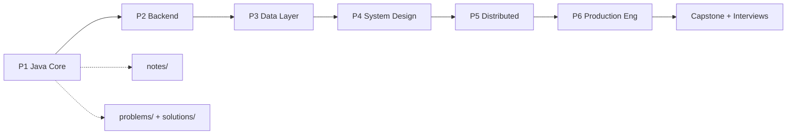

# Software Engineering Mastery

> A structured, end-to-end learning journey from **Java fundamentals** to **production-grade distributed systems** — notes, exercises, projects, papers, and reviews tracked in one place.

---

<!-- REPOSITORY METADATA: update repository settings using these values or keep this block in README for discoverability -->

| Field | Value |
|-------|-------|
| Repository | `winter000boy/Software-Engineering-Mastery` |
| Repo ID | `1338469511` |
| Short description (for GitHub "Description") | A structured, end-to-end learning roadmap from Java fundamentals through production-grade distributed systems — notes, exercises, and projects. |
| Primary language | Java |
| Topics (suggested) | java, backend, systems-design, distributed-systems, learning-path, roadmap |
| License | (none included) — add a LICENSE file (MIT recommended) |

Suggested topics to add in repository settings (comma-separated): java, backend, systems-design, distributed-systems, learning-path, roadmap

Suggested description to paste into GitHub repository settings (short): "A structured, end-to-end learning roadmap from Java fundamentals through production-grade distributed systems — notes, exercises, and projects."

---

A structured, end-to-end learning journey from **Java fundamentals** to **production-grade distributed systems** — notes, exercises, projects, papers, and reviews tracked in one place.

> **Master roadmap:** [Roadmap.csv](Roadmap.csv) — the single source of truth for every task, phase, and completion status.

---

## Vision

Build deep, practical mastery across the full backend and systems stack:

| Phase | Name | What you become capable of |
|-------|------|----------------------------|
| **P1** | Java Core | Write idiomatic, thread-aware Java; understand the JVM, collections, concurrency, and streams |
| **P2** | Backend Fundamentals | Design and ship REST APIs with Spring Boot, validation, testing, and clean layering |
| **P3** | Data Layer | Model schemas, optimize SQL, use JPA/Hibernate, Redis, migrations, and connection pooling |
| **P4** | System Design | Reason about scalability, caching, replication, CAP, messaging, and architecture trade-offs |
| **P5** | Distributed Systems | Build microservices, sagas, consensus patterns, and observable multi-service systems |
| **P6** | Production Eng | Containerize, CI/CD, secure, load-test, and operate software in production |

After P6, the roadmap includes a **Capstone** track (interview prep + a production-grade system of your choice) to consolidate everything.

---

## Current progress

| Phase | Tasks | Completed | Focus |
|-------|------:|----------:|-------|
| P1 Java Core | 91 | 4 | In progress — Java runtime & OOP foundations |
| P2 Backend Fundamentals | 100 | 0 | Not started |
| P3 Data Layer | 100 | 0 | Not started |
| P4 System Design | 100 | 1 | Not started |
| P5 Distributed Systems | 100 | 0 | Not started |
| P6 Production Eng | 100 | 0 | Not started |
| P6 Capstone | 62 | 0 | Not started |

Update `Status` in [Roadmap.csv](Roadmap.csv) (`TRUE` / `FALSE`) as you finish each task.

---

## Repository layout

```
Effective Java/
├── README.md              ← you are here (parent overview)
├── Roadmap.csv            ← full curriculum (~650 tasks, 6 phases)
├── INDEX.md               ← study notes index (serial = Roadmap.csv sr. no)
├── PROBLEMS-INDEX.md      ← problems + solutions index
│
├── notes/                 ← concept notes (Learn / Design / Review)
├── problems/              ← exercises & project briefs (Build / Flex / Project)
└── solutions/             ← worked solutions (same serial + slug as problems)
```

### Three content tracks

| Track | Folder | Index | Purpose |
|-------|--------|-------|---------|
| **Notes** | `notes/` | [INDEX.md](INDEX.md) | Deep-dive study material — theory, examples, interview angles |
| **Problems** | `problems/` | [PROBLEMS-INDEX.md](PROBLEMS-INDEX.md) | What to solve or build — exercises, projects, acceptance criteria |
| **Solutions** | `solutions/` | [PROBLEMS-INDEX.md](PROBLEMS-INDEX.md) | Worked answers — code, design docs, refactor logs |

Serial numbers match the `sr. no` column in [Roadmap.csv](Roadmap.csv) — e.g. `notes/004-...md` covers CSV row 4. Numbers are **not contiguous**: a file's number is whichever CSV row it covers, so gaps are expected wherever a row hasn't been written up yet. This makes it possible to tell which Roadmap rows are covered just by scanning folder listings.

---

## How each week is structured

Every focus area in [Roadmap.csv](Roadmap.csv) follows a repeating rhythm:

| Type | What you do |
|------|-------------|
| **Learn** | Read and understand a concept |
| **Build** | Implement something small and concrete |
| **Flex** | Exercises, Anki, gap-fill, or refactor |
| **Project** | Multi-day build (plan → build → test → document) |
| **Design/Theory** | Study + apply a design topic |
| **Paper** | Read a seminal paper; write summary + 3 takeaways |
| **Review** | Weekly spaced repetition and gap fixing |

Each focus block ends with a **capstone project** for that topic (e.g. CLI inventory, LRU cache, bookstore API, URL shortener design doc).

---

## Phase guide

### P1 — Java Core

**Focus areas**

- Java runtime & OOP foundations
- Collections & Generics
- Concurrency & Multithreading I
- Concurrency II + Streams/Functional

**Anchor projects**

| Project | Topic |
|---------|-------|
| CLI inventory system | Pure OOP, in-memory CRUD, tests, refactor |
| LRU cache | LinkedHashMap + manual implementation + benchmarks |
| Bounded blocking queue | Thread-safe queue + concurrency tests |
| Parallel word/log processor | ExecutorService + Streams |

**Primary resources:** *Effective Java* (Bloch), *Java Concurrency in Practice*, Java docs

**Notes so far:** [rows #001, #004, #012, #013 in INDEX.md](INDEX.md) · **Problems so far:** [rows #006–#011 in PROBLEMS-INDEX.md](PROBLEMS-INDEX.md)

---

### P2 — Backend Fundamentals

**Focus areas**

- HTTP, REST & Web foundations
- Spring Core & Boot
- Building robust APIs
- Testing & Spring internals

**Anchor projects**

| Project | Topic |
|---------|-------|
| Bookstore REST API design | OpenAPI spec + rationale |
| Spring Boot bookstore API | Controllers, services, DTOs, validation |
| Robust API extension | CRUD, pagination, error contract, integration tests |
| CI-ready test coverage | JUnit 5, Mockito, Spring Test |

**Primary resources:** Fielding REST dissertation, Spring Framework & Boot docs, JUnit 5 / Mockito

---

### P3 — Data Layer

**Focus areas**

- SQL deep dive
- JPA / Hibernate & transactions
- NoSQL & Redis
- Pooling, migrations & data consolidation

**Anchor projects**

| Project | Topic |
|---------|-------|
| E-commerce schema | Normalization + 10 optimized queries |
| Bookstore + PostgreSQL | JPA migration, N+1 fixes, transactions |
| Redis + MongoDB layer | Cache + read-heavy feature store |
| Data-layer capstone | Pooling, Flyway migrations, load test |

**Primary resources:** *SQL Performance Explained*, Hibernate / Vlad Mihalcea, HikariCP, Flyway

---

### P4 — System Design

**Focus areas**

- Scalability fundamentals
- Caching, CDN & partitioning
- Replication, consistency & CAP
- Messaging, async & consolidation

**Anchor projects (design write-ups + builds)**

| Project | Topic |
|---------|-------|
| URL shortener | Full system design document |
| News feed / timeline | Caching & fan-out |
| Distributed key-value store | Replication & consistency |
| Rate limiter + notifications | Messaging & async patterns |

**Primary resources:** *Designing Data-Intensive Applications* (Kleppmann), Kafka docs

---

### P5 — Distributed Systems

**Focus areas**

- Microservices architecture
- Resilience & distributed data
- Consensus & coordination
- Observability & consolidation

**Anchor projects**

| Project | Topic |
|---------|-------|
| Two-service microsystem | REST + Kafka communication |
| Saga + resilience | Circuit breakers, retries, distributed transactions |
| Distributed job scheduler | Coordination (Raft concepts) |
| Observability stack | Logs, metrics, traces across services |

**Primary resources:** *Building Microservices* (Newman), *Microservices Patterns* (Richardson), Raft paper, Google SRE Book

---

### P6 — Production Engineering

**Focus areas**

- Containers & orchestration
- CI/CD & DevOps
- Security
- Performance & reliability

**Anchor projects**

| Project | Topic |
|---------|-------|
| Containerized deploy | Docker Compose + basic Kubernetes |
| Full CI/CD pipeline | Build → test → image → deploy |
| OAuth2 / JWT + RBAC | Security review against OWASP Top 10 |
| Load test + performance report | End-to-end optimization |

**Primary resources:** Docker & Kubernetes docs, *Accelerate*, OWASP, *Java Performance* (Oaks)

**Capstone (final track):** production-grade backend of your choice + mock system design interviews — see rows tagged `P6 Capstone` in [Roadmap.csv](Roadmap.csv).

---

## Learning path (high level)



---

## Daily workflow

1. **Pick tasks** from [Roadmap.csv](Roadmap.csv) for the current phase and focus area.
2. **Learn** — request notes; new files land in `notes/` and [INDEX.md](INDEX.md) updates.
3. **Practice** — request exercises or project phases; files land in `problems/` and `solutions/`.
4. **Mark done** — set `Status` to `TRUE` in the CSV for completed rows.
5. **Review weekly** — use Review rows + Anki; revisit weakest topics via Flex rows.

### What to send each day

Examples:

- *"Notes: HashMap internals and treeify"*
- *"Problems: 3 exercises on synchronized blocks"*
- *"Continue P1 project: CLI inventory — build phase"*

---

## Conventions

| Item | Rule |
|------|------|
| Note files | `notes/NNN-topic-slug.md` |
| Problem files | `problems/NNN-topic-slug.md` |
| Solution files | `solutions/NNN-topic-slug.md` (same `NNN` and slug as problem) |
| Serial numbers | `NNN` = the matching `sr. no` row in `Roadmap.csv` — not contiguous, never reused for a different row |
| Projects | Plan → Build → Build (cont.) → Test & refactor → Document & review |
| Roadmap status | `TRUE` = done, `FALSE` = not done |

---

## Quick links

| Resource | Link |
|----------|------|
| Full task list | [Roadmap.csv](Roadmap.csv) |
| Study notes | [INDEX.md](INDEX.md) |
| Problems & solutions | [PROBLEMS-INDEX.md](PROBLEMS-INDEX.md) |

---

*Software Engineering Mastery — structured practice from first principles to production systems.*
